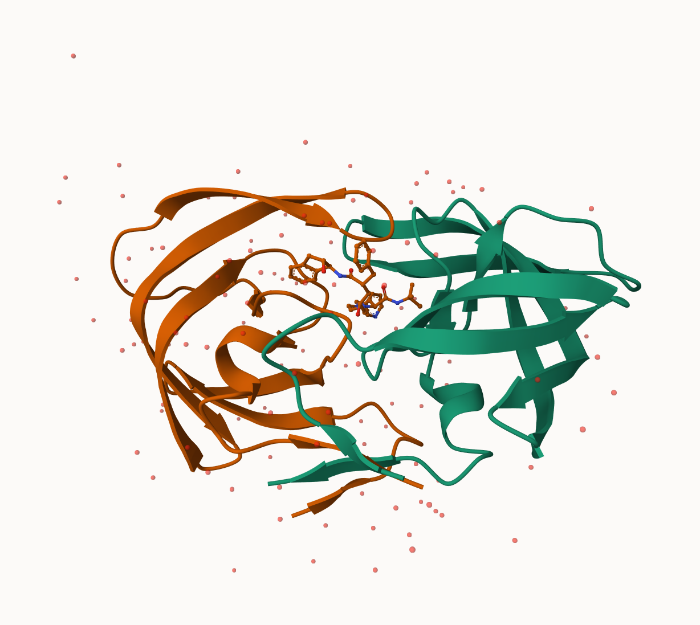
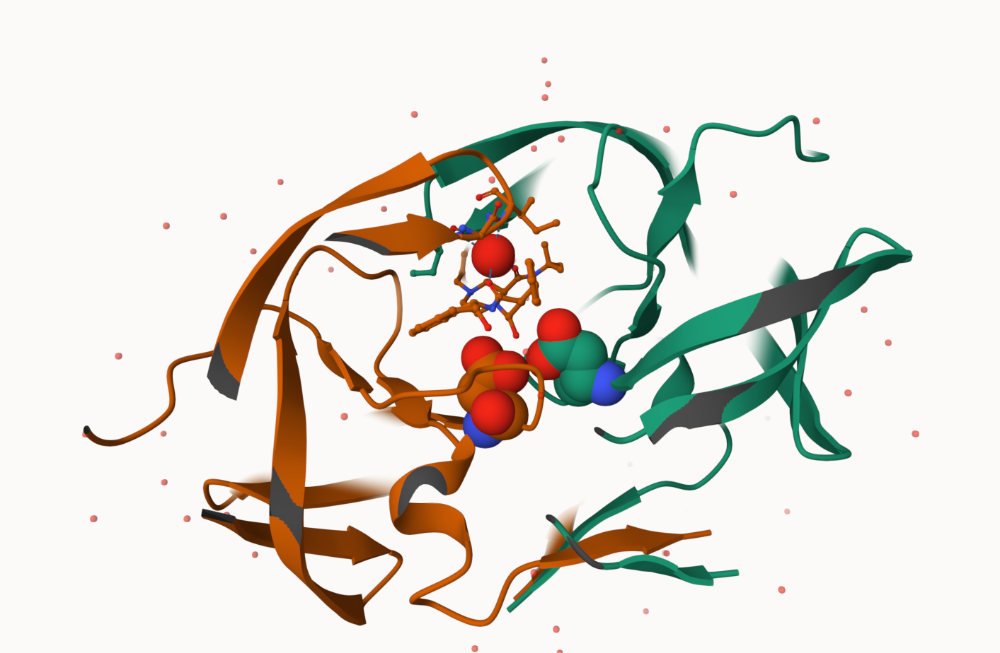
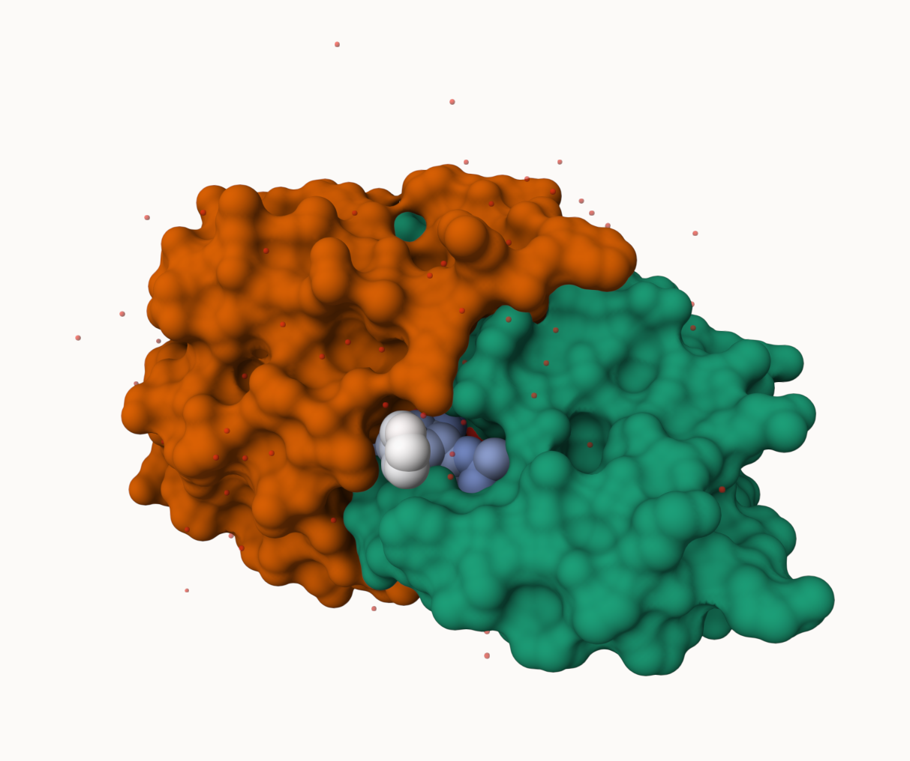

## Background

The [PDB databse] (https://www.rcsb.org/) is the main repository of biomolecular structure information. Let's have a look at the composition of this database:

Visit PDB and click: Analyze \> PDB Statistics \> Experimental Method \> Summary

We can "scrape" data from this page with the **datapasta** package that we can install from CRAN. `install.packages("datapasta")`

Then "Addins \> Paste as data.fram":

```{r, echo=FALSE}
pdb <- data.frame(
  stringsAsFactors = FALSE,
       check.names = FALSE,
           Molecular.Type = c("Protein (only)",
                              "Protein/Oligosaccharide","Protein/NA",
                              "Nucleic acid (only)","Other","Oligosaccharide (only)",
                              "Total"),
         `Xray.▼` = c(184731, 10716, 9341, 3216, 178, 11, 208193),
                EM = c(25754, 4037, 7520, 347, 27, 1, 37686),
               NMR = c(12904, 34, 288, 1599, 35, 6, 14866),
       Integrative = c(365L, 8L, 27L, 3L, 4L, 0L, 407L),
  Multiple.methods = c(232L, 11L, 8L, 15L, 0L, 1L, 267L),
           Neutron = c(86L, 1L, 0L, 3L, 0L, 0L, 90L),
             Other = c(32L, 0L, 0L, 1L, 0L, 4L, 37L),
             Total = c(224104, 14807, 17184, 5184, 244, 23, 261546)
       )

pdb
```

> Q1: What percentage of structures in the PDB are solved by X-Ray and Electron Microscopy.

```{r}
xray <- (pdb[7, 2])/pdb$Total[7] * 100
em<- (pdb[7,3])/pdb$Total[7] * 100

xray 
em

```

> Q2: What proportion of structures in the PDB are protein?

```{r}
(pdb$Total[1]) /pdb$Total[7]
```

> Q3: skipped !

## The Mol-star viewer

This viewer is embedded into many newer bioinformatics databases including the PDB and UniProt. The viewer is also accessible from its homepage: https://molstar.org



HIV-Protease is a critical HIV enzyme required for virus replication. It is an Aspartal protease, which means it uses Asp acid residues to cleave proteins.



 \> Q4: Water molecules normally have 3 atoms. Why do we see just one atom per water molecule in this structure?

We only see one atom per water molecule because the structure only shows the oxygen atoms. The hydrogen atoms are too small to be easily detected through X-ray crystallography.

> Q5: There is a critical “conserved” water molecule in the binding site. Can you identify this water molecule? What residue number does this water molecule have

The conserved water molecule is HOH 301, which is located in the binding site near the inhibitor. This water molecule is important because it forms hydrogen bonds that help stabilize the HIV-1 protease.

## Bio3D in R

The **bio3d** package is for structural bioinformatics and allows us to read structural data and preform bioinformatics analysis all within R:

```{r}
library(bio3d)

hiv <- read.pdb("1hsg")
```

```{r}
hiv
```

> Q7: How many amino acid residues are there in this pdb object?

198

> Q8: Name one of the two non-protein residues?

Water

> Q9: How many protein chains are in this structure?

Two protein chains

```{r}
head(hiv$atom)
```

```{r}
pdbseq(hiv)
```

### Quick structure viz in R

We can use the Bio3D partner package, **bio3dview**, to generate quick interactive molecular visualizations.

```{r}
library(bio3dview)
```

```{r}
view.pdb(hiv)
```

```{r}
# Select out two ASP 25 amino acids 
asp <- atom.select(hiv, resno=25)

## Draw them highlighted in Spacefill
view.pdb(hiv,
         highlight = asp,
         highlight.style = "spacefill", 
         backgroundColor = "skyblue") 
```

### Predict the dynamics of ADK

Let’s read a new PDB structure of Adenylate Kinase and perform Normal mode analysis.

```{r}
adk <- read.pdb("6s36")
m <- nma(adk)
plot(m)
```

Also make a little molecular moview (trajectory) for viewing in Mol-Star

```{r}
mktrj(m, file = "adk_dynamics.pdb")
```

```{r}
view.nma(m)
```


