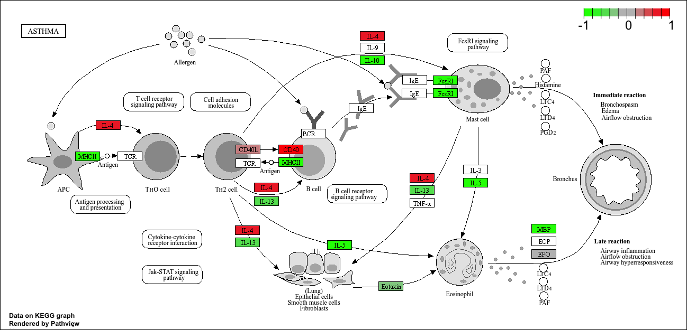
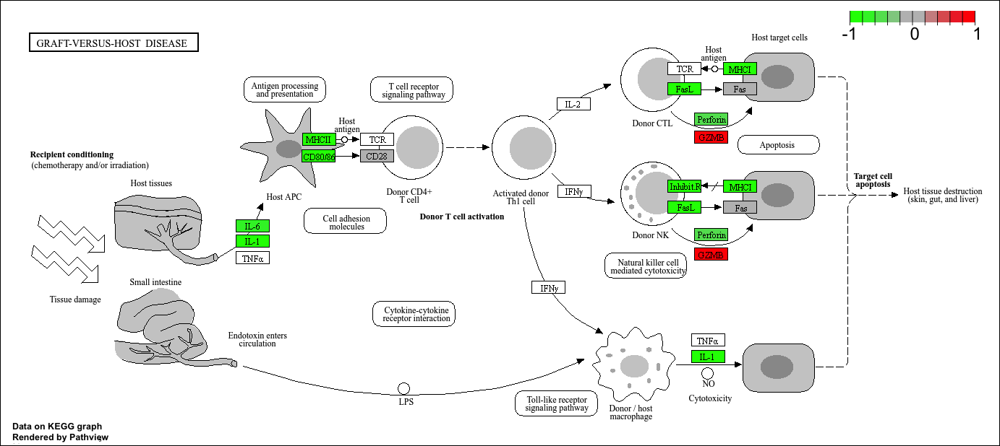
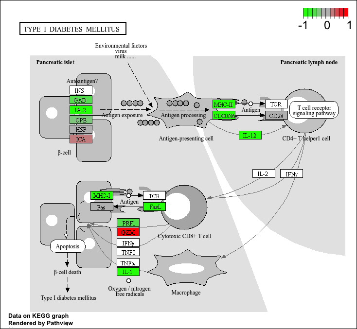

## Background

Today we will do out first RNASeq analysis of a dataset from a study of a common synthetic glucocorticoid, called dexamethasone, an airway smooth muscle cells.

## Data Import

```{r}
library(BiocManager)
library(DESeq2)
```

There are two input CSV files to read, the first so-called "counts" data the 2nd is metadata about the design of the experiment (i.e. the columns in "counts"):

```{r}
counts <- read.csv("airway_scaledcounts.csv", row.names=1)
metadata <- read.csv("airway_metadata.csv")
```

```{r}
head(counts)
```

```{r}
head(metadata)
```

> Q1. How many genes are in this dataset?

```{r}
nrow(counts)
```

> Q2. How many ‘control’ cell lines do we have?

```{r}
table(metadata$dex)
```

## Analysis

```{r}
head(counts)
```

### Our plan

We want to plan "control" vs "treated" (i.e no-drug vs rug experiments). We can calculate the mean count value for every gene (rows) in all 4 "control" experiments and compare it to the mean "count" value in all "treated" experiments (i.e. columns).

1.  Extract all "controls" columns
2.  Calculate the mean for each row (gene) of these columns

> Q3. How would you make the above code in either approach more robust? Is there a function that could help here?

`rowMeans()` instead of dividing by 4 so the code works with different numbers of samples. 

> Q4. Follow the same procedure for the treated samples (i.e. calculate the mean per gene across drug treated samples and assign to a labeled vector called treated.mean)

```{r}
control <- metadata[metadata[,"dex"]=="control",]
control.counts <- counts[,control$id]
control.mean <- rowSums( control.counts)/4
head(control.mean)
```

```{r}
#More robust form done in class 

control.inds <- metadata$dex == "control"

control.counts <- counts[,control.inds]
dim(control.counts)
control.mean <- rowMeans(control.counts)
```

```{r}
treated <- metadata[metadata[,"dex"]=="treated",]
treated.counts <- counts[,treated$id]
treated.mean <- rowSums(treated.counts)/4
head(treated.mean)
```

```{r}
#Method in class 

treated.mean <- rowMeans(counts[,metadata$dex == "treated"])
```

For easy bookkeeping, lets store these two mean values together in one data.frame called `mycounts`

```{r}
meancounts <- data.frame(control.mean, treated.mean)
```

> Q5 (a). Create a scatter plot showing the mean of the treated samples against the mean of the control samples. Your plot should look something like the following.

```{r}
plot(meancounts[,1],meancounts[,2], xlab="Control", ylab="Treated")
```

> Q5 (b).You could also use the ggplot2 package to make this figure producing the plot below. What geom\_?() function would you use for this plot?

```{r}
library(ggplot2)

ggplot(meancounts) + 
  aes(control.mean, treated.mean) + 
  geom_point(alpha=0.2)
```

> Q6. Try plotting both axes on a log scale. What is the argument to plot() that allows you to do this?

`log = "xy"` to put both axes on a log scale.

> Q(in-class): Re-draw or re-plot these on log-log axis scale.

```{r}
ggplot(meancounts) +
  aes(control.mean, treated.mean) +
  geom_point(alpha=0.2) +
  scale_x_continuous(trans="log2") +
  scale_y_continuous(trans="log2")
```

We can compare the mean values pf treated and control in terms of "log fold change values". Typically we use log2 units of "treated/controlled":

```{r}
# no change = 0
log2(20/20)
```

```{r}
# upregulation x2 = 1
log2(40/20)
```

Let's add our Log2 Fold Change `log2fc` values to your `meancounts` data frame.

```{r}
meancounts$log2fc <- log2(meancounts$treated.mean/meancounts$control.mean)
```

```{r}
head(meancounts)
```

A common threshold for calling a gene "up-regulated" is a log2fc value of +2. For "down-regulated" it is -2.

First, filter out zero count genes- as we can't say anything about them if we don't have any count data for them

```{r}
zero.vals <- which(meancounts[,1:2]==0, arr.ind=TRUE)

to.rm <- unique(zero.vals[,1])
mycounts <- meancounts[-to.rm,]
head(mycounts)
```

> Q7. What is the purpose of the `arr.ind` argument in the **which()** function call above? Why would we then take the first column of the output and need to call the **unique()** function?

The `arr.ind = TRUE` argument returns the row and column positions of each zero. Take the first column to get the row numbers of genes to remove. Use `unique()` to remove repeated row numbers because a gene can have zero counts in both columns.

A common threshold used for calling something deferentially expressed is a log2(FoldChange) of greater than 2 or less than -2. Let’s filter the dataset both ways to see how many genes are up or down-regulated.

```{r}
up.ind <- mycounts$log2fc > 2
down.ind <- mycounts$log2fc < (-2)
```

> Q8. Using the up.ind vector above can you determine how many up regulated genes we have at the greater than 2 fc level? 

```{r}
sum(up.ind)
```


> Q9. Using the down.ind vector above can you determine how many down regulated genes we have at the greater than 2 fc level? 

```{r}
sum(down.ind)
```

> Q10. Do you trust these results? Why or why not?

No, because they only compare mean counts and fold changes. They do not account for differences in sequencing depth or variation between samples, and they do not test statistical significance.

## DESeq

```{r}
library(DESeq2)
citation("DESeq2")
```

```{r}
dds <- DESeqDataSetFromMatrix(countData=counts, 
                              colData=metadata, 
                              design=~dex)
dds
```

```{r}
dds <- DESeq(dds)
```

```{r}
res <- results(dds)
```

## PCA 

Before DESeq analysis, use PCA to see how similar the samples are. First, `vst()` transforms the counts, then `plotPCA()` plots them.

```{r}
vsd <- vst(dds, blind = FALSE)
plotPCA(vsd, intgroup = c("dex"))
```

`plotPCA()` uses `intgroup = "dex"` to color samples by treatment group. It can also return the PCA data so you can create a custom plot with **ggplot2**.

```{r}
pcaData <- plotPCA(vsd, intgroup=c("dex"), returnData=TRUE)
head(pcaData)
```

```{r}
# Calculate percent variance per PC for the plot axis labels
percentVar <- round(100 * attr(pcaData, "percentVar"))
```

```{r}
ggplot(pcaData) +
  aes(x = PC1, y = PC2, color = dex) +
  geom_point(size =3) +
  xlab(paste0("PC1: ", percentVar[1], "% variance")) +
  ylab(paste0("PC2: ", percentVar[2], "% variance")) +
  coord_fixed() +
  theme_bw()
```

## DESeq Analysis 

`DESeq()` runs the analysis and adds the information needed to identify differentially expressed genes to `dds`. Save the updated object with:

```{r}
results(dds)
```

`dds <- DESeq(dds)` runs the full analysis: it adjusts for sequencing depth, estimates variation, and tests each gene for expression differences. The updated information is saved back into `dds`.

```{r}
dds <- DESeq(dds)
```

## Getting results 

```{r}
res <- results(dds)
res
```

We can summarize some basic tallies using the summary function.

```{r}
summary(res)
```

```{r}
res05 <- results(dds, alpha=0.05)
summary(res05)
```

## Adding Annotation 

Our main results to date are in the object called `res`. It has only ENSEMBLE IDs  at the moment. 
```{r}
head(res)
```

We will use two bioconductor packages to add gene symbols and entrez IDs to our results. These are **AnnotationDbi** and **org.His.eg.db**

To install these we need to use BiocManager `BiocManager::install()`

```{r}
library(AnnotationDbi)
library(org.Hs.eg.db)
```

Let's first have a peek at the different database formats we can "map" between: 

```{r}
columns(org.Hs.eg.db)
```

We can use the `mapIds()` function to translate or map our "ENSEMBLE" format rownames to gene "SYMBOL" etc. 

```{r}
res$symbol <- mapIds(org.Hs.eg.db,
                     keys=row.names(res), # Our genenames
                     keytype="ENSEMBL",        # The format of our genenames
                     column="SYMBOL",          # The new format we want to add
                     multiVals="first")

head(res)
```

> Q11. Run the mapIds() function two more times to add the Entrez ID and UniProt accession and GENENAME as new columns called `res$entrez`, `res$uniprot` and `res$genename`.

We can also add "GENENAME" and "ENTREZID", you can add these in the same way resulting in a `res$genename` and `res$entrez` columns in our main `res` results object: 

```{r}
res$genename <- mapIds(org.Hs.eg.db, 
        keys=rownames(res), # Our current IDs
        keytype="ENSEMBL", # Their current format
        column="GENENAME")

res$entrez <- mapIds(org.Hs.eg.db, 
        keys=rownames(res), # Our current IDs
        keytype="ENSEMBL", # Their current format
        column="ENTREZID")

res$uniprot <- mapIds(org.Hs.eg.db,
                     keys = rownames(res),
                     keytype = "ENSEMBL",
                     column = "UNIPROT",
                     multiVals = "first")

head(res)
```

You can arrange and view the results by the adjusted p-value

```{r}
ord <- order( res$padj )
#View(res[ord,])
head(res[ord,])
```

Finally, let’s write out the ordered significant results with annotations. See the help for ?write.csv if you are unsure here.

```{r}
write.csv(res[ord,], "deseq_results.csv")
```

## Data Visualization 

### Volcano Plots 

A very dull (i.e. non colored and labeled) version can be created with a quick call to **plot()** like so:

```{r}
plot( res$log2FoldChange,  -log(res$padj), 
      xlab="Log2(FoldChange)",
      ylab="-Log(P-value)")
```

To make this more useful we can add some guidelines (with the `abline()` function) and color (with a custom color vector) highlighting genes that have padj<0.05 and the absolute log2FoldChange>2.

```{r}
plot( res$log2FoldChange,  -log(res$padj), 
 ylab="-Log(P-value)", xlab="Log2(FoldChange)")

# Add some cut-off lines
abline(v=c(-2,2), col="darkgray", lty=2)
abline(h=-log(0.05), col="darkgray", lty=2)
```

To color the points we will setup a custom color vector indicating transcripts with large fold change and significant differences between conditions:

```{r}
# Setup our custom point color vector 
mycols <- rep("gray", nrow(res))
mycols[ abs(res$log2FoldChange) > 2 ]  <- "red" 

inds <- (res$padj < 0.01) & (abs(res$log2FoldChange) > 2 )
mycols[ inds ] <- "blue"

# Volcano plot with custom colors 
plot( res$log2FoldChange,  -log(res$padj), 
 col=mycols, ylab="-Log(P-value)", xlab="Log2(FoldChange)" )

# Cut-off lines
abline(v=c(-2,2), col="gray", lty=2)
abline(h=-log(0.1), col="gray", lty=2)
```

For even more customization you might find the `EnhancedVolcano` bioconductor package useful (Note. It uses `ggplot` under the hood):

```{r}
library(EnhancedVolcano)

x <- as.data.frame(res)

EnhancedVolcano(x,
    lab = x$symbol,
    x = 'log2FoldChange',
    y = 'pvalue')
```

## Pathway Analysis 

For analysis we need 3 more packages that I can install with `BiocManager::install(c("pathview", "gage", "gageData")`

```{r}
library(gage)
library(gageData)
library(pathview)
```

As input gage wants a simple vector of importance (e.g. our log 2 fold-change values) that has the correct gene IDs set as the `names()`. 

```{r}
x <- c(d=3, e=2, g=10)
```

```{r}
foldchanges <- res$log2FoldChange
names(foldchanges) = res$entrez
```

```{r}
data(kegg.sets.hs)
keggres = gage(foldchanges, gsets=kegg.sets.hs)
```

What is in our gage results? 

```{r}
attributes(keggres)
```

Look at the top 3 "down regulated" KEGG pathways

```{r}
head(keggres$less, 3)
```

We can take any of these "pathways" via their KEGG hsa ID and our `foldchanges` vector and see how our genes map to the pathway. 

```{r}
pathview(gene.data=foldchanges, pathway.id="hsa05310")
```



> Q12. Can you do the same procedure as above to plot the pathview figures for the top 2 down-reguled pathways?

```{r}
pathview(gene.data=foldchanges, pathway.id="hsa05332")
```



```{r}
pathview(gene.data=foldchanges, pathway.id="hsa04940")
```




