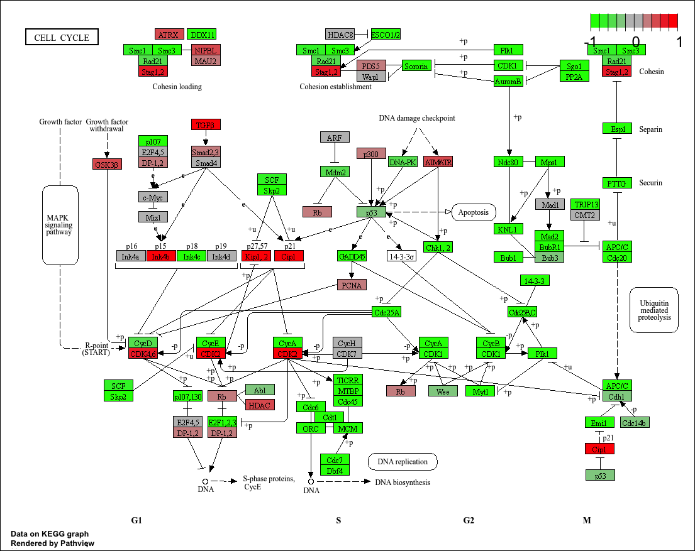

## Background 

The data for our hands-on session comes from GEO entry: GSE37704, which is associated with the following publication:

> Trapnell C, Hendrickson DG, Sauvageau M, Goff L et al. "Differential analysis of gene regulation at transcript resolution with RNA-seq". Nat Biotechnol 2013 Jan;31(1):46-53. PMID: 23222703

The authors report on differential analysis of lung fibroblasts in response to loss of the developmental transcription factor HOXA1. Their results and others indicate that HOXA1 is required for lung fibroblast and HeLa cell cycle progression. In particular their analysis show that "loss of HOXA1 results in significant expression level changes in thousands of individual transcripts, along with isoform switching events in key regulators of the cell cycle". For our session we have used their Sailfish gene-level estimated counts and hence are restricted to protein-coding genes only.

##Data Import 

```{r}
library(DESeq2)
```

```{r}
metaFile <- "GSE37704_metadata.csv"
countFile <- "GSE37704_featurecounts.csv"

# Import metadata and take a peek
colData = read.csv(metaFile, row.names=1)
head(colData)
```

```{r}
# Import countdata
countData = read.csv(countFile, row.names=1)
head(countData)
```

> Q. Complete the code below to remove the troublesome first column from `countData`: 

```{r}
# Note we need to remove the odd first $length col
countData <- as.matrix(countData[,-1])
head(countData)
```

> Q. Complete the code below to filter `countData` to exclude genes (i.e. rows) where we have 0 read count across all samples (i.e. columns).

```{r}
# Filter count data where you have 0 read count across all samples.
countData = countData[rowSums(countData) > 0, ]
head(countData)
```

## Run DESeq 

now lets setup the DESeqDataSet object required for the DESeq() function and then run the DESeq pipeline. 

```{r}
dds = DESeqDataSetFromMatrix(countData = countData,
                             colData = colData,
                             design = ~condition)
dds = DESeq(dds)
dds
```

Next, get results for the HoxA1 knockdown versus control siRNA (remember that these were labeled as "hoxa1_kd" and "control_sirna" in our original `colData` metaFile input to DESeq, you can check this above and by running `resultsNames(dds)` command).

```{r}
res = results(dds)
```

> Q. Call the summary() function on your results to get a sense of how many genes are up or down-regulated at the default 0.1 p-value cutoff.

```{r}
summary(res)
```

## Make a Summary Figure 

Now we will make a volcano plot, a commonly produced visualization from this type of data that we introduced last day.

```{r}
library(ggplot2)

ggplot(res) +
  aes(x = log2FoldChange,
      y = -log(padj)) +
  geom_point()
```

> Q. Improve this plot by completing the below code, which adds color, axis labels and cutoff lines:

```{r}
mycols <- rep("gray", nrow(res))

mycols[abs(res$log2FoldChange) > 2] <- "blue"

mycols[res$padj > 0.01] <- "gray"

ggplot(res) +
  aes(x = log2FoldChange,
      y = -log(padj)) +
  geom_point(color = mycols) +
  xlab("Log2(FoldChange)") +
  ylab("-Log(P-value)") +
  geom_vline(xintercept = c(-2, 2)) +
  geom_hline(yintercept = -log(0.01))

```

## Add Annotation Data 

Since we mapped and counted against the Ensembl annotation, our results only have information about Ensembl gene IDs. However, our pathway analysis downstream will use KEGG pathways, and genes in KEGG pathways are annotated with Entrez gene IDs. So lets add them as we did the last day.

> Q. Use the mapIDs() function multiple times to add SYMBOL, ENTREZID and GENENAME annotation to our results by completing the code below.

```{r}
library("AnnotationDbi")
library("org.Hs.eg.db")

columns(org.Hs.eg.db)

res$symbol = mapIds(org.Hs.eg.db,
                    keys = row.names(res),
                    keytype = "ENSEMBL",
                    column = "SYMBOL",
                    multiVals = "first")

res$entrez = mapIds(org.Hs.eg.db,
                    keys = row.names(res),
                    keytype = "ENSEMBL",
                    column = "ENTREZID",
                    multiVals = "first")

res$name = mapIds(org.Hs.eg.db,
                  keys = row.names(res),
                  keytype = "ENSEMBL",
                  column = "GENENAME",
                  multiVals = "first")

head(res, 10)
```

> Q. Finally for this section let's reorder these results by adjusted p-value and save them to a CSV file in your current project directory.

```{r}
res = res[order(res$padj), ]
write.csv(res, file = "deseq_results.csv")
```

## Pathway Analysis 

Here we are going to use the **gage** package for pathway analysis. Once we have a list of enriched pathways, we're going to use the **pathview** package to draw pathway diagrams, shading the molecules in the pathway by their degree of up/down-regulation. 

First we need to do our one time install of these required bioconductor packages, `BiocManager::install( c("pathview", "gage", "gageData") )`

Now we can load the packages and setup the KEGG data-sets we need.

```{r}
library(pathview)
library(gage)
library(gageData)

data(kegg.sets.hs)
data(sigmet.idx.hs)

# Focus on signaling and metabolic pathways only
kegg.sets.hs = kegg.sets.hs[sigmet.idx.hs]

# Examine the first 3 pathways
head(kegg.sets.hs, 3)
```

The main `gage()` function requires a named vector of fold changes, where the names of the values are the Entrez gene IDs.

Note that we used the `mapIDs()` function above to obtain Entrez gene IDs (stored in `res$entrez`) and we have the fold change results from DESeq2 analysis (stored in `res$log2FoldChange`).

```{r}
foldchanges = res$log2FoldChange
names(foldchanges) = res$entrez
head(foldchanges)
```

Now, let’s run the `gage` pathway analysis.

```{r}
# Get the results
keggres = gage(foldchanges, gsets=kegg.sets.hs)
```

Now lets look at the object returned from `gage()`.

```{r}
attributes(keggres)
```

Lets look at the first few down (less) pathway results:

```{r}
# Look at the first few down (less) pathways
head(keggres$less)
```

Now, let's try out the `pathview()` function from the **pathview package** to make a pathway plot with our RNA-Seq expression results shown in color. To begin with lets manually supply a `pathway.id` (namely the first part of the "hsa04110 Cell cycle") that we could see from the print out above.

```{r}
pathview(gene.data=foldchanges, pathway.id="hsa04110")
```



```{r}
# A different PDF based output of the same data
pathview(gene.data=foldchanges, pathway.id="hsa04110", kegg.native=FALSE)
```

Now, let's process our results a bit more to automagicaly pull out the top 5 upregulated pathways, then further process that just to get the pathway IDs needed by the `pathview()` function. We'll use these KEGG pathway IDs for pathview plotting below.

```{r}
## Focus on top 5 upregulated pathways here for demo purposes only
keggrespathways <- rownames(keggres$greater)[1:5]

# Extract the 8 character long IDs part of each string
keggresids = substr(keggrespathways, start=1, stop=8)
keggresids
```

Finally, lets pass these IDs in `keggresids` to the **pathview()** function to draw plots for all the top 5 pathways.

```{r}
pathview(gene.data=foldchanges, pathway.id=keggresids, species="hsa", gene.idtype = "entrez")
```

```{r}
library("knitr")

for (id in keggresids) {
  print(include_graphics(paste0(id, ".pathview.png")))
}
```

> Q. Can you do the same procedure as above to plot the pathview figures for the top 5 down-regulated pathways?

```{r}
keggrespathways_down <- rownames(keggres$less)[1:5]

keggresids_down <- substr(keggrespathways_down, start=1, stop=8)

keggresids_down
```

```{r}
pathview(gene.data=foldchanges,
         pathway.id=keggresids_down,
         species="hsa",
         gene.idtype="entrez")
```

## Gene Ontology 

We can also do a similar procedure with gene ontology.

```{r}
data(go.sets.hs)
data(go.subs.hs)

# Focus on Biological Process subset of GO
gobpsets = go.sets.hs[go.subs.hs$BP]

gobpres = gage(foldchanges, gsets=gobpsets)

lapply(gobpres, head)
```

## Reactome Analysis

Reactome is a database used to identify biological pathways and processes associated with genes. In this section, we will use significant genes from our previous differential expression analysis to perform pathway enrichment and topology analysis. Genes significant at the 0.05 level will be exported as a text file for further analysis.

```{r}
sig_genes <- res[res$padj <= 0.05 & !is.na(res$padj), "symbol"]
print(paste("Total number of significant genes:", length(sig_genes)))
```

```{r}
write.table(sig_genes, file="significant_genes.txt", row.names=FALSE, col.names=FALSE, quote=FALSE)
```

> Q: What pathway has the most significant “Entities p-value”? Do the most significant pathways listed match your previous KEGG results? What factors could cause differences between the two methods?

The most significant pathway identified by Reactome was Cell Cycle, Mitotic, with an Entities p-value of 1.48 × 10^-5^. Other highly ranked pathways included Cell Cycle, Cell Cycle Checkpoints, Mitotic Prometaphase, and Mitotic Spindle Checkpoint. These results do not appear to match exactly with the previous KEGG results, which included pathways such as steroid hormone biosynthesis. Differences between the two analyses may be due to variations in pathway definitions, gene annotations, and enrichment methods used by Reactome and KEGG.

